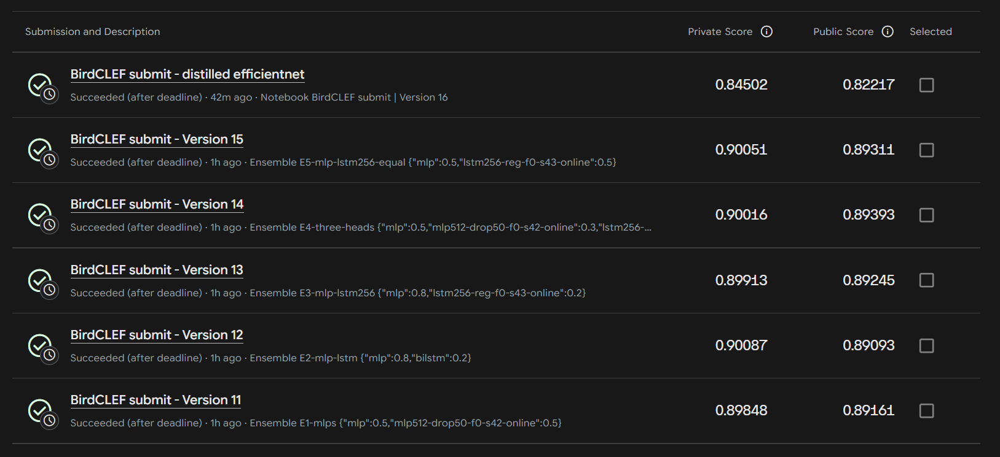
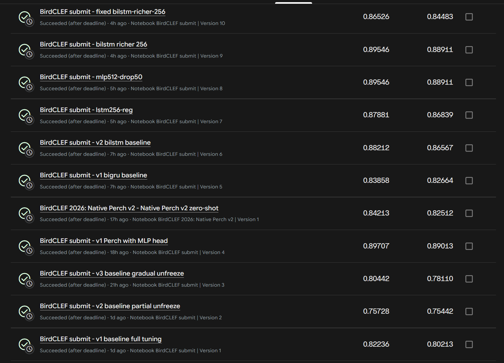

# BirdCLEF+ 2026

**Project:** [GitHub repository](https://github.com/sl4shuur/birdclef-2026)  
**Competition:** [BirdCLEF+ 2026](https://www.kaggle.com/competitions/birdclef-2026)  
**W&B report with training graphs:** [Overleaf Project with Graphs](https://www.overleaf.com/project/6ae3bc6cf45648027fa132d4/share#f880ce3b9ff6e9ae96348daecf3bcd37a033c4659e000eec)

## 1. Task

The goal is to find animal sounds in audio recordings from the Pantanal, Brazil. There are **234 classes**, including birds and other animals. More than one animal can be present at the same time, so this is a **multi-label classification** task.

A test recording is 60 seconds long. The model makes one prediction for each 5-second part. So one recording gives 12 rows in `submission.csv`.

The competition uses **macro ROC-AUC**. It checks how well the model puts positive examples above negative ones. Each class has the same weight. Classes with no positive examples are not used in the final average.

## 2. Data and EDA

I started with EDA to understand the audio and labels.

- The data has about **35,549 focal recordings**. They have clip-level labels. A short part of a clip may not contain the animal from its label.
- There are **66 soundscape recordings with annotations**, with **739 unique labeled 5-second windows** in my prepared data.
- The classes are not balanced. Some animals have many examples, but some have very few.
- Audio files have different lengths. I found short and quiet recordings too.
- The soundscape data is not balanced by recording site. This can make validation harder.
- Some soundscape windows have no annotations. I did **not** use them as negative labels.

I removed **370 focal clips shorter than one second** from training, but did not change the original audio files.

I also looked at other audio data and pretrained models. The focal data includes recordings from sources such as Xeno-Canto and iNaturalist. I did not add a new external training dataset in this project :(

*Explore `notebooks\kaggle\eda.ipynb` for detailed study and some figures*

## 3. Data preparation and validation

For my first CNN, I changed audio to mono, 32 kHz, and used 5-second windows. I converted the audio to Log-Mel spectrograms.

I used the given primary and secondary focal labels. For soundscapes, I used the available labels for exact 5-second windows. I saved the prepared files, class order, and validation folds.

For validation, I used **GroupKFold by soundscape recording**. Windows from the same recording do not go to both train and validation. I mainly used **fold 0** for quick tests. It has only **149 labeled windows** and ROC-AUC can be calculated for only **28 classes**. This means local results are not very stable...

The training set has focal clips and labeled soundscape windows. Validation uses soundscapes only, because they are closer to the test data.

## 4. Training and inference code

I wanted the code to be easy to read and use again. I separated data loading, audio processing, models, training, evaluation, and submission code.

The code supports different model settings, checkpoints, resume, and local validation. I used W&B for tracking my training runs.

Training curves and other graphs are in my [Overleaf Project with Graphs](https://www.overleaf.com/project/6ae3bc6cf45648027fa132d4/share#f880ce3b9ff6e9ae96348daecf3bcd37a033c4659e000eec)

## 5. Models I tried

### EfficientNet-B0 baseline

I first trained **EfficientNet-B0** with ImageNet weights. I changed its first layer to work with one-channel Log-Mel spectrograms. I tried full fine-tuning, partial unfreezing, and gradual unfreezing.

Full fine-tuning gave the best result of these CNN experiments. The other methods did not improve the score.

### Perch v2

Next, I tried **Perch v2**, a model trained for animal sounds. I first tested its original classification head without new training. It was stronger than my first CNN in the leaderboard results.

Then I used Perch as a **frozen feature extractor**. It gives a 1536-dimensional vector for each 5-second audio window. I saved these vectors in a cache and trained a small MLP head for the 234 classes. This gave a much better result. It was also fast to test new heads because Perch did not need to run again during training.

### Recurrent models

I also tested **BiGRU and BiLSTM** with Perch features. These models can use information from nearby 5-second windows in the same minute. For focal recordings, I used a sequence of length one. For soundscapes, I used 12 windows and masked positions with no labels.

I tried different hidden sizes, dropout, learning rates, and soundscape sampling. The LSTM was better than the GRU in my tests, but a single MLP was still stronger than a single recurrent model on the private leaderboard.

### Ensembles

Finally, I mixed predictions from some Perch MLP and LSTM models. This was a simple improvement and did not need more training. The ensemble gave my best private score so far.

## 6. Kaggle results

These are scores from my Kaggle submissions. **Higher is better.** Public and private scores come from different test parts.

| Model | Public ROC-AUC | Private ROC-AUC |
|---|---:|---:|
| EfficientNet-B0, full fine-tuning | 0.80213 | 0.82236 |
| Perch v2, original head (zero-shot) | 0.82512 | 0.84213 |
| Perch v2 + MLP | 0.89013 | 0.89707 |
| Perch v2 + BiGRU | 0.82664 | 0.83858 |
| Perch v2 + BiLSTM | 0.86567 | 0.88212 |
| MLP + LSTM ensemble (v12) | 0.89093 | **0.90087** |
| Three-head ensemble (v14) | **0.89393** | 0.90016 |

The best **private score** is **0.90087**. The best **public score** is **0.89393**, from a different submission.

The local AUC was not always close to the leaderboard score. For example, a larger LSTM had good local results, but it did not beat the MLP on private data. This shows why I should test on more folds.

## 7. Knowledge distillation — results pending

I also made a **Perch -> EfficientNet-B0** distillation experiment.

In the first stage, Perch is the **teacher** and EfficientNet-B0 is the **student**. The student learns to make features similar to Perch features. I use a cosine similarity loss and a small projection layer.

After this I use the student encoder with a new classification head. I train it with the normal labels and BCE loss.

Here are the results:

| Experiment | Kaggle notebook version | Local ROC-AUC | Public | Private |
| --- | --- | ---: | ---: | ---: |
| ImageNet EfficientNet-B0, full fine-tuning (historical baseline) | BirdCLEF submit, v1 | 0.87771 | 0.80213 | 0.82236 |
| Perch feature distillation -> EfficientNet-B0 full fine-tuning | BirdCLEF submit, v16 | **0.89463** | **0.82217** | **0.84502** |

## 8. Limitations

I had **little time**, so I tried only a small number of ideas. I did not do a large hyperparameter search.

I trained my models using the selected training folds. **I did not retrain the final models on all available training recordings** after model selection. So the final models did not use all possible training data.

My local validation set is small and has labels for only some classes. Some species are rare. Focal clips also have weak labels: the animal may not be present in each 5-second crop. The soundscape recordings come from different sites, so results may change on new sites.

I used a frozen Perch encoder in most strong experiments. This saved training time, but it may limit the final quality. I also did not test many data augmentation methods.

## 9. What I would try next

With more time and compute, I would:

1. **Try to Fine-tune Perch** on the competition data, not only train a new head.
2. **Add more audio data**, especially for rare classes and animal groups with few examples.
3. **Use pseudo-labeling:** use a strong model to find likely animal sounds in audio without labels, then train on high-confidence predictions. I would check these labels carefully.
4. **Make synthetic soundscapes** from focal recordings. I would choose clips with similar background sound, place animal sounds at known times, and use short crossfades to make smooth joins. This could give more training sequences for GRU/LSTM. I would also keep synthetic recordings separate from validation.
5. **Try audio augmentation**, like noise, time shifts, Mixup, or SpecAugment.
6. **Use more folds and more training data** for the final model, then test the best ensemble again.

## 10. Conclusion

My first EfficientNet baseline was much weaker than Perch with a small trained head. Recurrent layers did not always help alone, but mixing MLP and LSTM predictions improved the final private score.

I think the main next step is better training data and better use of Perch. The project code is ready for more experiments, but I would also like to spend more time on validation and real test conditions.

---

**AI tools:** I used AI tools to help with ideas, explanations, planning, and code review. I checked the code and the experiment results myself.
